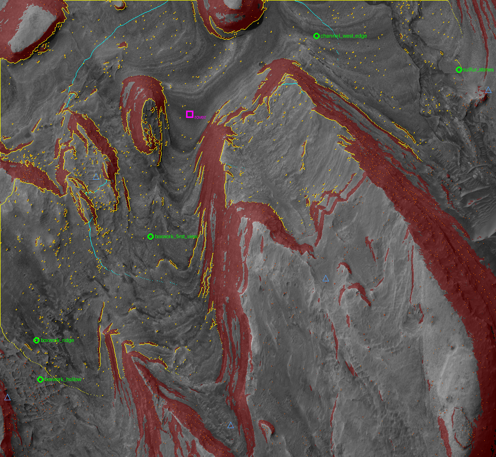

# ARIADNE

**Astronaut Route Intelligence And Data for Navigation & Exploration** (crew shorthand: "Ari")

A map and suit display for one astronaut on one Marswalk: Real NASA data, safe routes, a science plan, and a live boundary showing how far they can go and still get home.

> The boxwork is a labyrinth. Every labyrinth needs a thread.

Built by Team Stuff for the NASA hackathon challenge "Interplanetary Survival Guide: Martian Map" (14 to 15 November 2026).

Deployed URL: https://ariadne-kappa.vercel.app/

## The problem

When astronauts walk on Mars they ask three questions, "where can I safely go, how much science can I do, and can I still get home?" They walk to do science in stiff suits, carrying tools and samples, with limited time and oxygen, on steep and broken ground. Yet every Mars map today was built for scientists studying a whole planet, not for the person standing on it. On our ~2 km Marswalk patch, 18% of the ground is steeper than 25°.

## What exists and what is missing

- Map portals (planet scale, for scientists): Mars Trek, the USGS global geologic map, JMARS. Gap: global scale, no walking time, no consumables, no suit view. [Mars Trek](https://trek.nasa.gov/mars/jpl/config/textAbout.html), [USGS](https://www.usgs.gov/publications/digital-global-geologic-map-mars-chronostratigraphic-ages-topographic-and-crater), [JMARS](https://jmars.mars.asu.edu/what-jmars)
- Rover mission tools (robots, ground teams): MMGIS and OnSight. Gap: team platforms for robotic missions, with no human metabolic cost or return logic, and OnSight is limited to federal staff and contractors. [MMGIS](https://github.com/NASA-AMMOS/MMGIS), [OnSight](https://software.nasa.gov/software/NPO-50830-1)
- Human EVA tools: Minerva (xGDS, SEXTANT, Playbook), used in BASALT analog EVAs. Gap: its authors report unusable time estimates, a constant walking speed, no terrain traversability, and poor fit for replanning during an EVA. [Marquez 2019](https://pmc.ncbi.nlm.nih.gov/articles/PMC6442304), [xGDS](https://software.nasa.gov/software/ARC-17174-1)
- LunaNet: a proposed Moon communications and navigation network. Gap: it tells you where you are, not which ground is safe. [NTRS](https://ntrs.nasa.gov/citations/20200001555)

The gap: no tool we found combines real Mars terrain data, a suit-calibrated walking cost, consumables, and a continuously updated safe-return boundary for one astronaut on one walk, offline, in both a habitat view and a suit view. Details: [docs/system_design.md](docs/system_design.md#design-rationale).

## ARIADNE

In Greek myth, Ariadne gave Theseus a thread so he could find his way out of the labyrinth. Our site, the boxwork ridges of Gale Crater, is a natural labyrinth, so ARIADNE gives the astronaut a thread of their own: the Thread, the boundary of everywhere they can go and still walk back to the rover in time.

Features, grouped under the three questions (built means working in the app today):

Where can I safely go?
- No-go terrain from the 1 m HiRISE terrain model: steep slopes, large rocks, rough ground (built).
- Fast, safe and smooth (any-angle, Theta*) routes, with rerouting when a hazard changes (built).
- Alerts that come with an action, for example "Solar storm: the rover is driving out to meet you. [ROUTE]", with a storm watch and countdown 30 min ahead.
- Conditions: weather replay, radiation, Mars time (in progress, Stage 3).

How much science can I do?
- Knots: science stops with real Curiosity photos and the tasks to do there 
- Science plan and science budget: walking time with the load carried, and what still fits before the crew must turn back 
- Task check-off on the Suit HUD 

Can I still get home?
- The Thread, scaled by the load carried and recalculated as time passes 
- Suit HUD with at most 3 numbers at once 

Two views of the same map:
- Planning Table: the habitat and rover display, a big map with all layers, used to plan 
- Labyrinth view: the 3D terrain of the Marswalk 

Shelters are the rover and terrain overhangs, never Knots. Every displayed value is traceable (dataset, product ID, resolution, timestamp, uncertainty) and model-derived values are labelled "est.".

## A Marswalk in 60 seconds

1. On the Planning Table, plan all 5 Knots: total est. 5 h 03 min of the 5 h 30 min limit, with an est. 27 min science budget left. The plan says GO
2. The crew walks out from the rover along the fast route. The Thread is drawn around the rover
3. At each Knot the crew collects samples. Samples add load, and the Thread shrinks
4. A space weather watch warns that a radiation storm is likely in about 30 min, with a live countdown
5. The May 2024 solar storm that Curiosity measured arrives. The science plan stops, and the pressurised rover drives out along the route back while the astronaut walks towards it
6. They meet halfway (est. about 19 min sooner than walking all the way back), the astronaut boards, and the samples are safe

The astronaut's position is simulated for the demo, and the weather and storm are a replay of real historical data (see "Honest limits").

Stage 1 output preview: no-go zones, rocks, Knots, rover and Thread contours on the HiRISE photo.

## Why this site and this scenario

- Two of Curiosity's headline discoveries are about 2 km apart: pure sulfur in Gediz Vallis and the groundwater boxwork ridges. One walk can visit both.
- HiRISE covers the patch at 1 m with no gaps, so the terrain model is detailed enough for walking.
- Curiosity's own photos and measurements let us check the map against reality.
- The scenario follows Artemis planning: a pressurised rover drives the crew to a staging point, then they walk in pairs. How far a crew may walk is limited by what a suit can walk back. The staging point is about 1.1 km from each target, inside the Artemis III 2 km excursion radius (D-003, D-018, D-020).

## Why you can trust it

- The terrain model's slopes match Curiosity's own measured tilt: median 8.8° against 8.4° at 205 stops.
- The app's walking times match the pipeline's within 0.0006% (largest relative difference 5.6e-6 over every Knot to rover route).

Honest limits:
- The data is a replay of real historical measurements, not live
- Walking speed, load and task times are estimates, labelled "est."
- The astronaut's position is simulated. Mars has no GPS; a real mission would use rover radio ranging, visual odometry or a future navigation network

## Data we use

- HiRISE terrain model and photo: where the safe ground is, and the 3D view
- Curiosity REMS (weather) and RAD (radiation) replay, plus NASA DONKI space weather: conditions and the solar storm
- Curiosity photos and science blog posts: the Knots
- CRISM minerals and THEMIS thermal inertia: context only, low confidence

Product IDs, URLs, resolutions, licences, processing and status for every dataset are in [docs/data_sources.md](docs/data_sources.md).

## Space Apps submission

Tagline:

> ARIADNE: the Marswalk map with a thread that always leads the astronaut home.

Project summary (197 words; the form suggests 50 to 200):

> Imagine the first astronauts walking on Mars. They are there for science, collecting samples and carrying tools in stiff spacesuits, with limited oxygen, steep broken ground and solar storms that strike without warning. Yet every Mars map today was made for planetary scientists, not for an explorer asking: where can I safely go, how much science can I do, and can I still get home?
>
> We built ARIADNE, named after the thread that led Theseus out of the labyrinth. Our pipeline fuses real NASA data (HiRISE terrain, Curiosity weather, radiation and photos, CRISM minerals, THEMIS thermal inertia) into one map of a 2 km Marswalk in Gale Crater. On it we are building a planning table, a 3D view and a suit display. ARIADNE routes the crew through science stops, like Curiosity's sulfur stones and boxwork ridges, each with its sampling task, while avoiding steep ground and large rocks. Walking times account for the suit and the load carried. The Thread marks how far the crew can go and still walk back to their rover, so they always know their remaining science time.
>
> Exploration succeeds only when explorers return with discoveries. ARIADNE balances both at every step.

## For developers

To set up, run and test everything, see [docs/getting_started.md](docs/getting_started.md). All rules for agents and humans are in [AGENTS.md](AGENTS.md), and the current stage, gate checklists and next steps are in [docs/handoff.md](docs/handoff.md).

Roles:
- Lawrence Lian Anak Matius Ding (Team Leader): Stage 1, data and algorithms pipeline. Branch `dev-lawrence`.
- Malissa: Stage 2, app shell, Labyrinth view, Planning Table, routing, Thread. Branch `dev-malissa`.
- Letta: Stage 3, Suit HUD, alerts, simulation clock, demo and pitch. Branch `dev-letta`.

Branch flow:
- Work only on your own `dev-{firstname}` branch, updated from `dev` before you start.
- When your stage gate passes, push and tell Lawrence.
- Lawrence merges into `dev`, runs the integration check, then merges `dev` into `main`.

Documentation map:
- [AGENTS.md](AGENTS.md): the single instruction file for every agent and human (read order, directory map, ownership, git workflow, rules).
- [CLAUDE.md](CLAUDE.md): only imports `AGENTS.md` for Claude Code.
- [docs/getting_started.md](docs/getting_started.md): setup, run and test commands for the pipeline and the app.
- [docs/system_design.md](docs/system_design.md): architecture, local grid, components, algorithms, UX principles, design rationale.
- [docs/contracts.md](docs/contracts.md): exact file formats between stages, walking-time formula, test vectors.
- [docs/data_sources.md](docs/data_sources.md): every dataset with product ID, URL, resolution, licence and status.
- [docs/decisions.md](docs/decisions.md): append-only decision log.
- [docs/handoff.md](docs/handoff.md): current stage, gate checklists, known issues and next steps.
- [docs/development_conventions.md](docs/development_conventions.md): code, doc and git conventions.
- [docs/log/person_a.md](docs/log/person_a.md), [docs/log/person_b.md](docs/log/person_b.md), [docs/log/person_c.md](docs/log/person_c.md): session logs for each team members' agents

Repository map:
- `docs/`: design, contracts, data sources, decisions, handoff, per-person logs and images.
- `pipeline/`: Python data pipeline (Stage 1). Python via `uv`: rasterio (GDAL), numpy, scipy, scikit-image.
- `app/`: React, Vite, TypeScript, Zustand, Tailwind and React Three Fiber (Stages 2 and 3), built. It is a static site; the hosting platform is Vercel. The app works only in a local metre grid.
- `data/`: `raw/` (git-ignored downloads), `processed/` (pipeline outputs, committed), `reference/` (app reference data such as the real solar storm dose curve).

## License and data credits

The ARIADNE code is under the MIT License. See [LICENSE](LICENSE).

The data and images are not covered by the MIT License. They stay under their providers' terms. NASA data and imagery are generally not copyrighted in the United States, but NASA asks for credit and does not endorse this project. Use the credit line given for each source below.

Datasets and images:

- HiRISE orthoimage `PSP_009149_1750_RED_A_01_ORTHO` (texture, and the input to rock detection). Credit: NASA/JPL/University of Arizona.
- HiRISE terrain model `DTEEC_009149_1750_009294_1750_U01` (slope, roughness and the 3D view). Credit: NASA/JPL/University of Arizona.
- MRO CRISM summary parameters `FRT0000B6F1_07_SR165J_MTR3` and `FRT000058A3_07_SR165J_MTR3` (mineral context). Credit: NASA/JPL/JHUAPL MRO CRISM team, via the PDS Geosciences Node. Summary parameters: Viviano-Beck et al. (2014), JGR Planets 119, doi:10.1002/2014JE004627.
- THEMIS thermal inertia mosaic `THEMIS_TI_Mosaic_Quant_30S120E_100mpp` (context). Credit: Mars Odyssey THEMIS, ASU/USGS (USGS Astropedia, public domain). Please also cite Fergason, Christensen and Kieffer (2006), JGR 111, E12004, doi:10.1029/2006JE002735, and Edwards et al. (2011), JGR 116, E10009.
- Curiosity REMS weather, `RME_820012645RMD47600000000_______P1` (sol 4760), dataset `MSL-M-REMS-5-MODRDR-V1.0`. Credit: NASA/JPL-Caltech, MSL REMS (CAB, Spain), via the NASA PDS Atmospheres Node.
- Curiosity RAD radiation, `RAD_RDR_2025_360_10_42_4760_V00` (sol 4760) and `RAD_RDR_2024_140_18_30_4190_V00` (sol 4190), dataset `MSL-M-RAD-3-RDR-V1.0`. Credit: NASA/JPL-Caltech, MSL RAD (SwRI, DLR), via the NASA PDS Planetary Plasma Interactions Node.
- NASA DONKI space weather, CME `2024-05-20T05:36:00-CME-001`. Credit: NASA CCMC DONKI. Event facts: NASA/JPL news.
- Curiosity Navcam photos (14 images, sols 4210 to 4650, in `app/public/knots/`), from the NASA Curiosity raw image archive, https://mars.nasa.gov/msl-raw-images/. Credit: NASA/JPL-Caltech.
- Curiosity traverse waypoints `MSL_waypoints.json` (stop positions and sols). Credit: NASA/JPL-Caltech. Source: https://mars.nasa.gov/mmgis-maps/MSL/Layers/json/MSL_waypoints.json
- Gale regional image from the Viking MDIM 2.1 colorized global mosaic, `Mars_Viking_MDIM21_ClrMosaic_global_232m`. Credit: NASA/JPL/USGS Astrogeology Science Center (public domain).
- Sun position and Mars time, Mars24 algorithm (no dataset). Credit: NASA GISS.

Product IDs, processing and status for each dataset are in [docs/data_sources.md](docs/data_sources.md).

This project is not affiliated with or endorsed by NASA.
